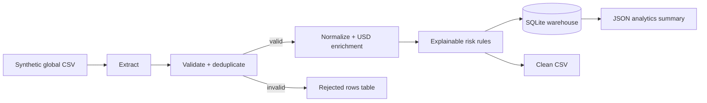

# Worldwide Transactions Data Pipeline

A portfolio-ready, dependency-free Python ETL project based on the processing ideas in the supplied bank-statement TDD. It generates synthetic transactions across ten countries, validates and normalizes them, converts values to USD using fixed demo rates, hashes account identifiers, assigns explainable risk signals, quarantines bad rows, and loads analytics-ready tables into SQLite.

All records are synthetic. No live banking data, credentials, paid APIs, or network access are used.

## Architecture



## What the pipeline demonstrates

- Deterministic dummy-data generation for IN, US, GB, DE, BR, SG, NG, AE, JP, and AU.
- Schema validation, ISO country/currency normalization, timezone checks, and duplicate handling.
- Fixed-rate multi-currency conversion for a reproducible offline demo.
- SHA-256 account pseudonymization before clean data is persisted.
- Explainable risk bands based on high value, cross-border activity, wire channel, and failed status.
- Data-quality quarantine with the original row and rejection reason.
- Atomic SQLite loading, indexed analytics tables, run metadata, clean CSV, and JSON summary.
- Standard-library-only implementation and tests.

## Quick start

From this folder, with Python 3.10+:

```powershell
python run_pipeline.py demo --count 1000 --seed 42
python -m unittest discover -s tests -v
```

Generated files:

```text
data/raw/world_transactions.csv     synthetic source data
output/clean_transactions.csv       validated and enriched rows
output/world_transactions.db        SQLite warehouse (ignored by Git)
output/summary.json                  country/category analytics
```

You can also run stages separately:

```powershell
python run_pipeline.py generate --output data/raw/world_transactions.csv --count 5000
python run_pipeline.py run --input data/raw/world_transactions.csv --output-dir output
```

## Tables

| Table | Purpose |
| --- | --- |
| `clean_transactions` | Normalized, pseudonymized, risk-enriched facts |
| `rejected_transactions` | Bad/duplicate rows with deterministic reasons |
| `pipeline_runs` | Source path, timestamps, and row counts for every run |

## Risk rules

| Signal | Points |
| --- | ---: |
| USD value at least 10,000 | 45 |
| Cross-border transaction | 25 |
| Wire channel | 15 |
| Failed status | 20 |

Bands are `LOW` (0-29), `MEDIUM` (30-59), and `HIGH` (60-100). These are transparent demo rules, not a fraud model and not suitable for real financial decisions.

## Production extension path

Replace the CSV extractor with Kafka/object storage, fixed FX values with a versioned rates table, SQLite with a warehouse, and local scheduling with Airflow/Dagster. Add a schema registry, secret-managed hashing key, observability, idempotent partition loads, retention policies, and human-reviewed risk logic before using real data.
